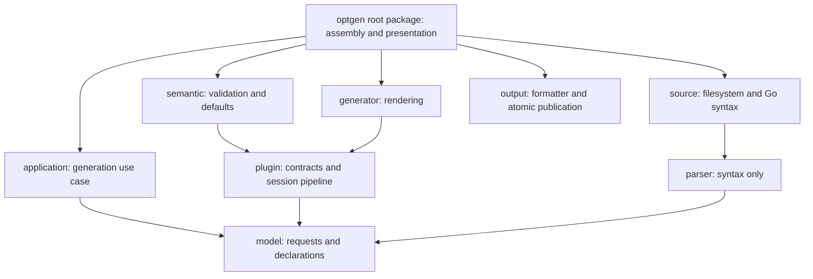

# Architecture

The generation use case owns the operation sequence. CLI and filesystem adapters supply its ports; models and plugin contracts never import those
adapters. Required dependencies are explicit constructor parameters and each invocation assembles a fresh plugin registry.

## Boundaries

| Package | Responsibility | Allowed inner dependencies |
|---------|----------------|----------------------------|
| `model` | Generation data, field declarations, import information | Standard library |
| `plugin` | Extension contracts, explicit catalogs, pipeline execution | `model` |
| `internal/application` | Parse, prepare, render, publish through ports | `model` |
| `internal/parser` | Extract syntax without applying plugin policies | `model`, `internal/naming` |
| `internal/semantic` | Validate checks, apply the option prefix, resolve type defaults, default normalization, default modifiers and settings policies (`defaults-from=none`, `with-isset`) | `model`, `plugin` |
| `internal/generator` | Render prepared input; applies no policy | `model`, `plugin` |
| `internal/source` | Load and type-check Go packages (`go/packages`), invoke syntax extraction with type facts | `model`, `internal/parser` |
| `internal/output` | Run a formatter and atomically publish successful output | Standard library |
| `internal/naming` | Derive option names from field names | Standard library |
| `internal/plugin/builtin` | Register the built-in plugins | `plugin`, its sub-packages |
| `internal/plugin/builtin/*` | One plugin family each; `fields` may use the `fieldtmpl` template helpers | `model`, `plugin` (`fields`: also `fieldtmpl`) |
| `config` | Decode and merge `.optgen.yaml` documents; no I/O | Standard library, `yaml.v3` |
| `internal/rootcmd` | Cobra root command and version output | Standard library, Cobra |
| `cmd/optgen` | Binary entry point | `optgen` |
| `optgen` (module root) | Assemble implementations, find and read configuration, adapt CLI input, present progress | Inner packages and adapters |

## Decisions

| Decision | Reason |
|----------|--------|
| Per-invocation registry and warning sink | Disabled plugins and diagnostics must not leak between commands. |
| Registration errors instead of overwrites | A key, alias or name owned by two plugins makes one of them silently unreachable. |
| Separate key namespaces | `optgen`/`optval` keys select transforms and modifiers; `optcheck` keys select check plugins only. |
| Checks validate applicability | A check that cannot handle a field type fails preparation instead of generating nothing. |
| Policies derived from descriptors | Default modifiers and disablers are semantic policies computed from `Registry.Descriptors`, not registry queries. |
| Generated code imports the standard library | Generated files must compile in any module, including the altessa-s modules that run optgen. |
| Explicit registration | Importing a package must not change generation behavior. |
| One pipeline | All field handlers share ordering, value propagation, and termination semantics. |
| Syntax before semantics | Parsing remains deterministic regardless of registered extensions. |
| Type facts through a parser port | The parser consumes `TypeResolver` facts; only the source adapter depends on `go/packages`. |
| Plugins compiled in | Third-party plugins register through `optgen.WithPlugins` in a wrapping `main`; nothing is loaded at runtime. |
| Format before publication | Failed formatting preserves the previous generated file. |
| Generated constructor options | Package tunables follow the same option conventions as generated consumers. |
| Settings verified by the use case | `RenderSettings.Verify` runs in `application.Service`, so every caller, not only the CLI, rejects unknown modes. |
| Default normalization through plugins | Type-specific rewriting of tag defaults (e.g. `30s` for `time.Duration`) is a `DefaultNormalizer` hook, not a semantic branch. |

## Plugin contracts

The pipeline runs guards, transforms, post-processors, and checks in order. `OutputVar` becomes the input to subsequent modifiers and the final
assignment. `Final` stops generation of subsequent modifiers and assignment; it must only be set when the plugin emits a terminal statement on every
path. A generated conditional `return` leaves `Final` false. Transform plugins run in tag order before modifier plugins in the transform phase; check
plugins run by priority and key after modifier plugins in the check phase. Metadata keys are sorted to keep generation deterministic. Field plugins
receive the value pipeline (`plugin.Pipeline`, `BuildPipeline` only) as a `Generate` argument; check rendering for the generated validation
function is a generator-side interface. `GenerationContext` carries generation data and collects the imports plugins emit (`AddImport`).

The CLI registers only the built-in plugins; external shared objects are not loaded. Plugin implementations must keep per-generation mutable state
in the generation context, not in package globals or shared plugin instances.

## Verification

`TestDependencyDirection` enforces the import rules of every package in the table, and fails for a package without a rule; `TestNoInitOrDynamicLoading`
rejects `init` functions and the standard library `plugin` package repo-wide. Contract tests cover pipeline substitution, every field handler with and
without error results, and disabled checks; CLI tests verify session isolation. Golden tests review output changes and type-check standard-library
fixtures. Parser fuzz targets check tag round trips and list invariants. Run `make generate`, `go test -race -shuffle=on ./...`, `go vet ./...`, and
`golangci-lint run ./...` after architecture changes.
